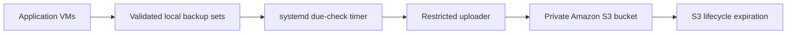

# Reference architecture

**English** | [Español](../es/architecture.md)

This repository describes a reference disaster-recovery workflow for a small Proxmox homelab. Hostnames, addresses, domains, resource names, and production paths are intentionally omitted.

## Services in scope

| Service | Protected state | Cadence |
|---|---|---|
| Nextcloud | MariaDB dump, configuration, package and app inventory | Every 15 days |
| Nginx Proxy Manager | SQLite snapshot, configuration, and compose definition | Every 15 days |
| Pi-hole | DNS configuration and logical rules export | Every 15 days |
| Plex and supporting apps | Databases, preferences, native application archives, and qBittorrent state | Every 15 days |
| Plex metadata | Internal metadata and media assets paired with application state | Monthly |

## Design

Each backup set contains a manifest, SHA-256 checksums, and a `COMPLETE` marker. The uploader transfers only completed sets and verifies remote object size and checksum metadata.

## Security boundaries

- Private S3 bucket with SSE-S3 encryption and public access blocked.
- IAM identity restricted to the service backup prefixes.
- HTTPS-only bucket policy.
- No object-deletion permission on the application hosts.
- S3 lifecycle expiration applies retention by object age.

## Adaptation notes

The scripts contain example application paths and service names. Review every path, mount, database name, container name, schedule, and restore procedure before using them in another environment.
