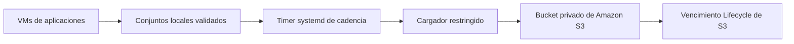

# Arquitectura de referencia

[English](../en/architecture.md) | **Español**

Este repositorio describe un flujo de recuperación ante desastres de referencia para un homelab Proxmox pequeño. Se omiten intencionalmente hostnames, direcciones, dominios, nombres de recursos y rutas de producción.

## Servicios incluidos

| Servicio | Estado protegido | Cadencia |
|---|---|---|
| Nextcloud | Dump MariaDB, configuración e inventario de paquetes y apps | Cada 15 días |
| Nginx Proxy Manager | Snapshot SQLite, configuración y definición compose | Cada 15 días |
| Pi-hole | Configuración DNS y exportación lógica de reglas | Cada 15 días |
| Plex y auxiliares | Bases, preferencias, archivos nativos de aplicaciones y estado qBittorrent | Cada 15 días |
| Metadata de Plex | Metadata y recursos internos junto con estado de aplicación | Mensual |

## Diseño

Cada conjunto tiene un manifiesto, checksums SHA-256 y un marcador `COMPLETE`. El cargador transfiere solo conjuntos completos y verifica tamaño y metadatos de checksum remotos.

## Límites de seguridad

- Bucket S3 privado con cifrado SSE-S3 y acceso público bloqueado.
- Identidad IAM limitada a prefijos de respaldo de servicios.
- Política de bucket que exige HTTPS.
- Sin permiso de borrar objetos en los hosts de aplicaciones.
- Vencimiento Lifecycle de S3 para retención por antigüedad.

## Notas de adaptación

Los scripts contienen rutas y nombres de servicio de ejemplo. Revisar cada ruta, montaje, nombre de base, contenedor, horario y procedimiento de restauración antes de usarlos en otro entorno.
